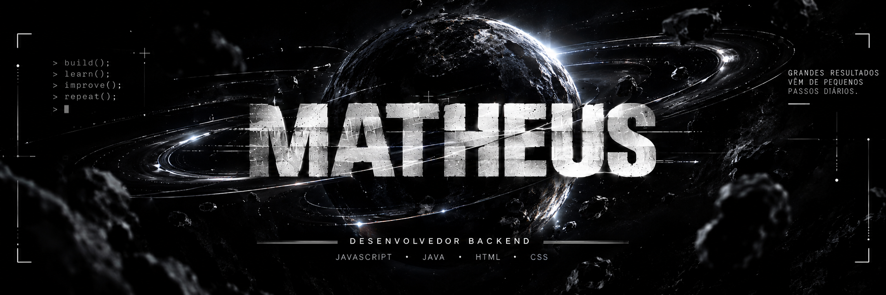

# Olá, sou o Matheus

### Desenvolvedor Backend

Desenvolvendo sistemas backend confiáveis, com arquitetura limpa e soluções escaláveis.

---

## Sobre mim

**Matheus** aqui — um desenvolvedor focado em aprender, criar projetos e evoluir na prática.

- 💻 Trabalhando com **JavaScript, Java, HTML e CSS**
- 🧠 Interessado em desenvolvimento backend e resolução de problemas
- 🛠️ Aprendendo ao desenvolver projetos e melhorar meu código
- 🎯 Objetivo: criar softwares confiáveis e continuar evoluindo como desenvolvedor

 

---

## Contatos

&nbsp;&nbsp;

&nbsp;&nbsp;

---

## 💻 Tecnologias

---

## Gráfico de atividade

 

<picture>
  <source media="(prefers-color-scheme: dark)" srcset="https://raw.githubusercontent.com/duque31/duque31/output/pacman-contribution-graph-dark.svg">
  <source media="(prefers-color-scheme: light)" srcset="https://raw.githubusercontent.com/duque31/duque31/output/pacman-contribution-graph.svg">
  
</picture>

---

<i>Continue criando. Continue aprendendo. Continue evoluindo.</i>

